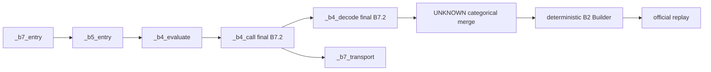

Decoded all16 final Libraries; binding_audit.json lists ALL definition lines and last definitions.

Aliases preserve earlier implementations, whose global prompt/decode lookups reach final overrides. Final class transport remains _b7_transport.
